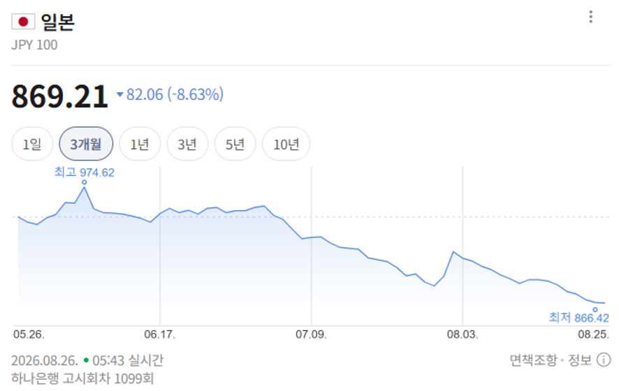
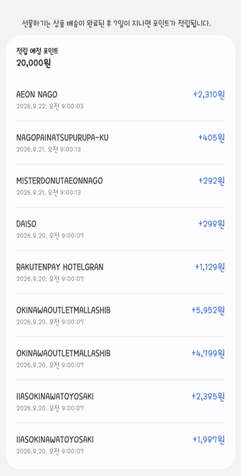

# 엔화가 날이면 날마다 떨어진다.

작년 말, 올해 초에만 해도 930원대도 싸다고 했었는데, 최근에 860원대까지 엔화가 떨어지니 여행지로서의 메리트가 더 올라갔다. 😊 분명히 돈을 쓰는데, 벌고 있는 것 같은 느낌이다. 푸드코트 같은 곳에서 돈까스 하나, 스테이크 하나, 포케 하나를 시켜도 외식비가 4만원이 넘지 않는다. GU에 가서 반팔 티셔츠를 하나 고르면 한 장에 만원이 넘지 않는다. 그래서 올해 여름 휴가도 '오키나와'로 정했다. 벌써 8번째 여행이다. 5번은 가야 한대서 '5키나와'라고도 한다고 했는데, 8번이나 가게 될 줄은 몰랐지만, 익숙함이 주는 편안함이 있는 것도 사실이다.  물론, 가장 큰 이유는 아이가 '[파인애플 파크](https://www.nagopine.com/)'를 기억하고 언제 또 가냐고 노래를 불렀기 때문이기도 하다. 😇

# 이번 여행에서 챙겼던 현지 결제 이벤트
난 항상 해외 여행을 갈때, [여행의 재미는 소비에 있다.]() 에서 말한 것처럼 각종 카드사들의 현지 결제 이벤트를 챙긴다. 최근에 '트래블' 카드류의 경쟁이 더 심화되기도 해서 소비자 입장에서는 매우 환영할만한 일이다. 물론, 카드가 많아져서 쓸 때마다 신경을 써야하는 것은 사실이지만, 삼성월렛을 쓰는 사용자의 경우 요즘 대부분의 일본 매장에서도 Touch 결제를 지원하기 때문에 혜택을 뽑아 먹는 데 큰 어려움은 없을 것 같다. 

| **우선순위** | **카드명**                         | **사용처**              | **사용금액**                 | **혜택**                                  | **비고**        |
| -------- | ------------------------------- | -------------------- | ------------------------ | --------------------------------------- | ------------- |
| 1        | KB트래블러스 체크(나)                   | 유나이티드 렌터카            | 16,440엔                  | 해외가맹점 10% 할인(1만원 한도)                    | Master     |
| 2        | KB트래블러스 체크(아내)                  | -                    | 11,274엔                  | 해외가맹점 10% 할인(1만원 한도)                    | 환율 887.38엔 기준 |
| 3        | 삼성월렛 트래블로그 체크(나)                | Touch 결제 가능(삼성페이)    | 22,548엔                  | - 해외가맹점 10% 적립(2만원 한도) - 배라 싱글 레귤러   | 환율 887.38엔 기준 |
| 4        | 삼성월렛 트래블로그 체크(아내)               | Touch 결제 가능(삼성페이)    | 22,548엔                  | 해외가맹점 10% 적립(2만원 한도) - 배라 싱글 레귤러     | 환율 887.38엔 기준 |
| 5        | 리브메이트(나)                        | UnionPay             | 건당 8,000엔 이상(최대 32,000엔) | - 10% 즉시 할인(최대 3회) - 건당 최대 3,190엔 할인 | 잔여예산 확인       |
| 6        | KB트래블러스 체크 리브메이트(아내)         | 세븐일레븐 로손 패밀리마트 | 건당 1,000엔 이상             | 건당 500엔 외화머니 적립(최대 5회)                  | 기본 혜택 중복가능    |
| 7        | 네이버페이 머니카드(나) 네이버페이 머니카드(아내) | 세븐일레븐 로손 패밀리마트 | 합산 3만원(3,400엔) 이상        | 1만원 페이백                                 |               |
| 8        | 네이버페이 머니카드(나) 네이버페이 머니카드(아내) | 유니클로                 | 합산 5만원(5,700엔) 이상        | 2만원 페이백                                 |               |
| 9        | 하나 트래블로그(나) 하나 트래블로그(아내)     | 세븐일레븐 로손 패밀리마트 | 합산 2만원(2,300엔) 이상        | 3천 하나머니 적립                              |               |
| 10       | 하나 트래블로그(나) 하나 트래블로그(아내)     | 유니클로                 | 합산 5만원(5,700엔) 이상        | 5천 하나머니 적립                              |               |
| 11       | 하나 트래블GO(나)                     | 맥도날드                 | 합산 2만원(2,300엔) 이상        | 5천 하나머니 적립                              |               |
| 12       | 하나 트래블GO(나)                     | 다이소                  | 합산 5만원(5,700엔) 이상        | 5천 하나머니 적립                              |               |
| 13       | 더모아                             | -                    | 합산 5만엔(45만원) 이상          | 배민 5만원 상품권                              |               |
| 14       | BC GOAT                         | -                    |                          | 6% 적립(수수료 1.2% 별도)                      |               |

이번 8월 중순에 여행 가면서 정리했던 표다.  최근에 [KB 트래블러스 카드](https://card.kbcard.com/CRD/DVIEW/HCAMCXPRICAC0076?mainCC=a&cooperationcode=09564)의 경우 전월실적 20만원 이상일 경우 '**온·오프라인 해외 가맹점 10% 할인(월 1만원 한도)**' 혜택이 추가되었다.  또, 얼마전에 새로 출시한 [삼성월렛 하나 트래블로그 체크카드](https://m.hanacard.co.kr/MKCDCM1000M.web?CD_PD_SEQ=19264)의 경우에도 KB 트래블러스 카드와 마찬가지로 전원실적 20만원 이상일 경우 '**삼성 페이 해외 오프라인 결제시 10% 적립(월 1만원 한도)**' 혜택을 제공한다. 물론, 출시 이벤트로 **올해 12월 말까지는 10% 적립(월 2만원 한도)** 이다.  카드를 새로 발급하는 경우 수령일로부터 익월말까지는 실적이 없어도 혜택이 적용되기 때문에 다음달에 '싱가포르' 여행을 고려해서 발급했는데, 20만원 사용하는 건 일도 아니었다. 😇 어찌됐던 무지성 10% 할인 카드들이 이렇게 새로 나오는 건 매우 환영할 만한 일이다.  부부가 어디든 해외여행을 간다면 우선 60만원 사용시 6만원 할인 혹은 적립인 셈이니 어떤면에서는 국내에서 쓰는 것 보다 나은 측면이 있다. 

그리고 위 테이블에서 보면 알겠지만, **KB의 일본 편의점 혜택은 압도적**이다. 👍 트래블러스 카드 자체 혜택과 중복 적용이 되므로 **50% 이상 할인이 되는 셈**이다.  그것도 카드당 5회이다 보니 아내랑 나는 10번의 기회가 있었지만 다 사용은 못했다. 또, **유니클로의 경우 네이버페이 머니 카드를 이용하면 5만원에 2만원 페이백**이다.  5,500엔 이상이면 Tax Free로 할인을 받다 보니 이 정도면 사라고 대놓고 부추기는 정도라 봐야 한다. 😁

한편, UnionPay는 시즌별로, 카드사별로 **매번 10% 즉시할인 이벤트를 진행중**이다.  그래서 카드사별로 UnionPay 카드를 만들어둬야 하나 심각하게 고민중이기도 하다. JCB는 '스시로', '돈키호테'와 같은 특정 가맹점 20% 할인 혹은 적립 같은 형태로 혜택을 제공한다면 **UnionPay는 특정 금액 이상이면 10% 즉시할인으로 프로모션**을 한다. 8월 중순 기준 IBK, NH농협, 신한, KB 모두 동일한 형태의 프로모션을 진행중이었고, 최소 결제금액과 횟수는 조금씩 차이는 있지만 모두 10% 즉시할인에 더 좋은 건 '1인당'이 아니라 **'카드당' 혜택**이기 때문에 호텔 숙박료나 고액 결제할 때 아주 쏠쏠하다.  한편, 살펴보니 KB의 UnionPay 고객이 제일 많은 건지 한도 소진이 제일 빨랐다. 😇 8월 말까지 이벤트였는데, 이미 8월 중순에 잔여 예산이 1% 였던 터라 결국 나는 혜택을 받지 못했다. 😂

- [유니온페이 IBK 개인 신용/체크카드](https://marketing.unionpayintl.com/offer-promote/?language=kr&insCode=299990156&countryCode=410&province=0#/offer?couponno=260623112493&couponType=07&merchantNo=898314918094224&createFlag=01)
- [유니온페이 NH농협 개인 신용/체크카드](https://marketing.unionpayintl.com/offer-promote/?language=kr&insCode=299990156#/offer?couponno=260728112644)
- [유니온페이 신한 개인 신용카드](https://marketing.unionpayintl.com/offer-promote/?language=kr&insCode=299990156#/offer?couponno=260422112151)

이제 9월이면 추석 연휴와 10월에도 개천절, 한글날을 비롯한 꽤 쏠쏠한 연휴가 많다. 새로운 이벤트들이 또 쏟아져 나올텐데 기대가 된다. 🙏 이번 추석 연휴에 '싱가포르' 여행을 갈텐데, 그 때도 이만큼 혜택이 있다면 #3 를 포스팅 하는 걸로 마무리하겠다. 