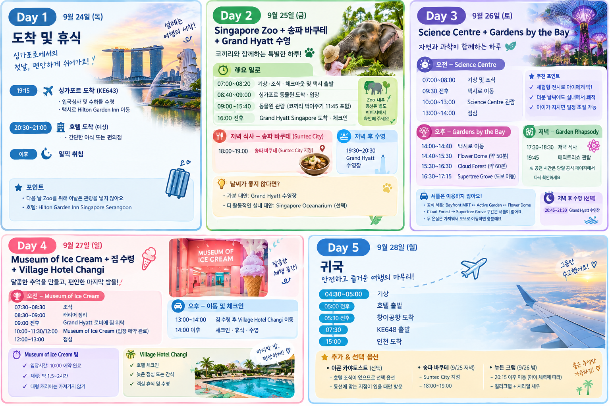
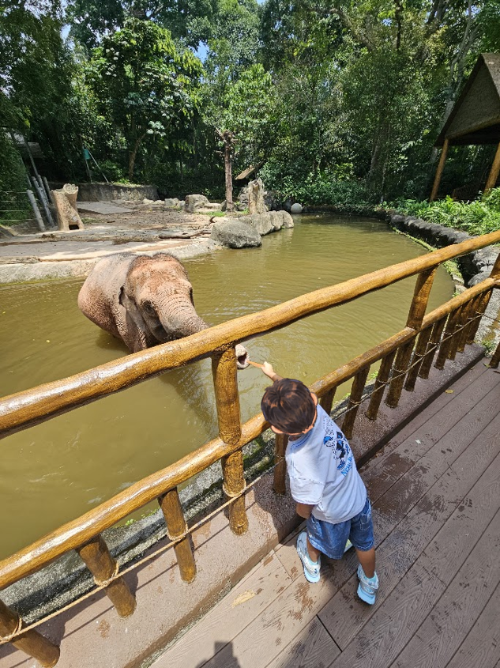
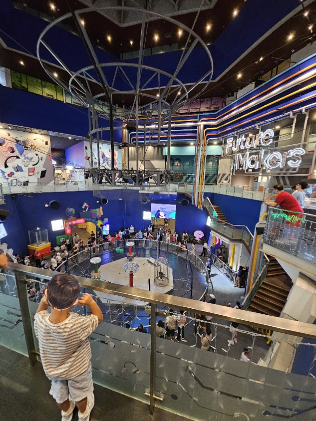
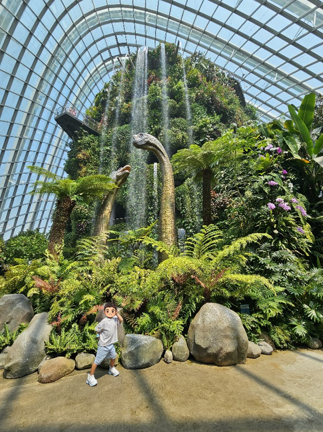
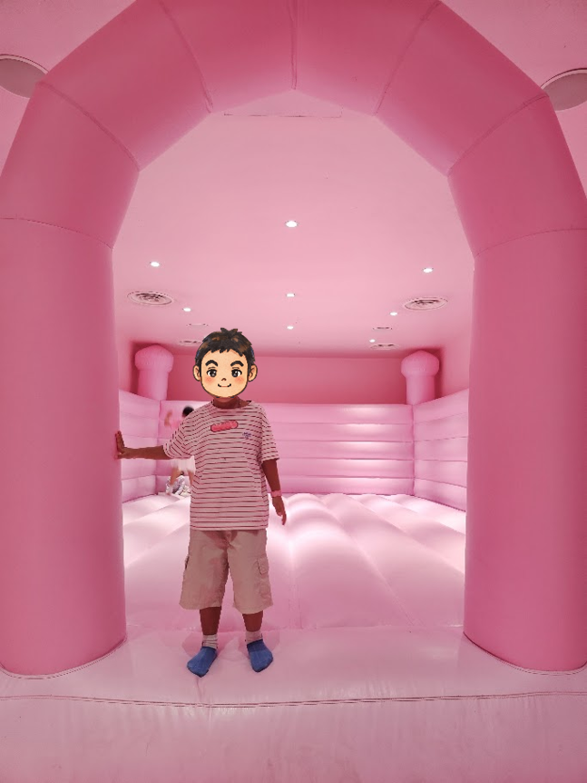
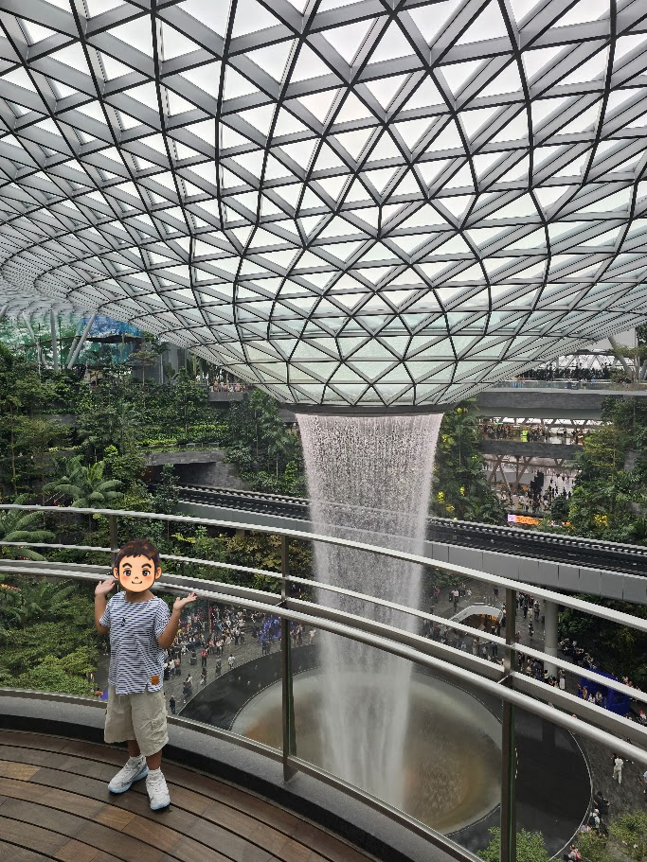

---

# 싱가포르는 사진만 찍는 도시인 줄 알았다.

오키나와에서 결제 이벤트를 정리하면서 추석 연휴 싱가포르를 예고했었다. ([여행의 재미는 소비에 있다. #2편]()) 
9월 24일부터 28일까지 추석 연휴에 4박 5일, 6세 뽀짝이와 처음 가는 싱가포르였다.  
과거에 아내와 연애를 할 때도, 작년에 출장을 올 때도 깨끗하고 발달된 도시이긴 하지만 사진 말고는 크게 임팩트가 있었던 기억은 없었다.  설 연휴에 왔을 때 마리나 베이에서 크게 터뜨렸던 불꽃놀이 정도가 기억에 남는데, 사실 그 보다 덥고 습했던, '3보 이상 탑승'을 해야만 했던 날씨에 대한 기억이 더 컸다. 😂
그래서인지 어른들에게 싱가포르는 유니버셜 스튜디오나 머라이언 앞에서 사진 찍는 정도의 도시로 알려져 있다.  
그런데 아이와 가보니 얘기가 달랐다.  즐길거리가 은근히 많다. 어쩌면 아이들에게는 '천국'이라는 표현이 맞을지도 모르겠다. (어른은 특별히 해당사항 없음 😇) 
이번 여행의 원칙은 하나였다. 
무조건 많이 보는 여행이 아니라, 6세 아이가 즐겁게 끝낼 수 있는 여행으로 꾸린다. 그도 그럴 것이 6시간이 넘는 비행시간이기도 하고, 처음 장거리 비행을 하는터라 컨디션도 꽤나 신경이 많이 쓰였다.  
한 달 전 오키나와에서 물놀이를 실컷 하고 와서 워터파크(어드벤쳐 코드)는 일정에서 뺐다. 
대신 동물원, 과학관, 아이스크림 박물관을 넣었다. 하루에 큰 일정 하나씩이다.

# 일정표

# 첫날(9/24)은 도착만

KE643, 인천 13:50 출발, 싱가포르 19:15 도착. 
입국심사와 수하물을 마치고 택시로 Hilton Garden Inn Singapore Serangoon에 들어갔다. 호텔 도착은 20시 반쯤이었다. 인천공항에 10시쯤 도착했으니 사실상 이동에만 '하루'가 꼬박 소요된 셈이다.  밤 비행기가 훨씬 저렴하긴 했지만, 비행기에서 제대로 잘 수 있을지도 모르겠고 작년에 밤 비행기로 돌아오는 항공편에서 '병든 닭 처럼 졸던' 내 모습이 떠올라서 비싸도 무조건 낮 비행기로 이동하기로 했다. 모르긴 몰라도 밤 비행기보다 낮 비행기가 80만원 가까이 비쌌다. 😇 
저녁 도착이다보니 이날은 관광을 넣지 않았다. 다음 날 Zoo를 위해서 말이다.  그럼에도 불구하고 뽀짝이가 갑자기 컨디션이 급격히 떨어지더니 이내 열이 났다.  독감이 한참 유행하던 시즌이라 다음날 동물원이 아니라 소아과에 가야되나 별걸 다 찾아봤는데, 결과적으로는 '**피곤해서**' 났던 열이었다. 6살 아이한테도 6시간이 넘는 비행은 어른 못지 않게 힘든 일이었다. 😣

# 둘째 날(9/25): 코끼리 먹이주기

아침 8시 30분, Hilton을 체크아웃하고 Grand Hyatt Singapore로 먼저 갔다. 
Zoo에 가기 전에 짐을 맡길 생각이었다. 로비에서부터 안내해주더니 8시 30분에 체크인을 해줬다. 심지어 라운지에서 조식도 먹고 가라고 한다. (이럴 줄 알았으면 힐튼에서 아침 안 먹고 왔지!) 확실히 5성급의 대접은 다른 느낌이랄까, 이렇게 또 자본주의의 노예가 된다. 😇  
28인치 캐리어를 어디에 둘지 고민했는데, 체크인이 바로 되는 바람에 모든게 해결됐다. 
만다이 라커에 넣을지, 배송 서비스를 쓸지까지 따져봤던 고민이 한 번에 끝났다.

Zoo에 도착해서는 11:45 Elephant Feeding을 중심으로 움직였다.  코끼리 먹이주기를 놓치지 않는 것이 일정의 핵심이였다.  
먹이주기는 종류가 여럿인데, 기린·얼룩말 먹이주기는 키 120cm 이상 조건이 붙어 있었다. 
아직 120cm가 안되는 뽀짝이는 코끼리 먹이주기만 가능했다. 다른 먹이주기도 같이 했으면 좋았겠지만, 코끼리를 그렇게 가까이에서 먹이를 줄 수 있는 경험도 흔치는 않다. 그 덕에 **벽 한 켠에 코끼리와 찍은 가족사진이 붙어 있게 됐다.** 😊  

오전에는 Elephant Feeding 주변을 먼저 보고, 오후에는 그늘 구역과 Wild Africa, KidzWorld 순으로 마무리했다. 
트램이 있긴 하지만 동물원은 꽤나 넓어서 완주는 욕심이다.  코끼리, 오랑우탄, 아프리카 동물, KidzWorld. 이 네 가지가 핵심이었다. 
점심은 Zoo 안에서 해결했다. 싱가포르까지 가서 KFC를 먹을 거라 생각하진 않았지만, 아이한테는 익숙한 것 만큼 좋은 음식이 없다. '**치킨** 🍗'  
저녁식사로 계획에 있던 송파 바쿠테는 이번 여행에서는 먹지 않았다. 대신 그랜드 하얏트 이그제큐티브 라운지를 아주 잘 이용했다. 라운지에 수영장도 잘 되어 있다보니 굳이 밖에서 먹을 필요를 못 느끼기도 했고, 중심가에 있어서 왔다갔다 하기가 무척 편했다.  
저녁 식사 후에는 19시 반부터 한 시간 수영, 물놀이 안 좋아하는 6세 아이는 없는 것처럼 매일가도 좋아했다. 😊

# 셋째 날(9/26): 싱가포르 어린이 과학관은 최고다.

Science Centre Singapore, 오전 10시부터 13시까지, 세 시간을 잡았다. 
직접 만져보는 전시, 과학 실험, 움직임 중심의 체험이 가득했다. 
**세계적인 어린이 과학관이라는 말이 아깝지 않은 곳이었다.**  하루 종일 놀아도 손색없는 수준이다. 👍 그 중 불쇼, 전기쇼도 하는데, 클라스가 다른 느낌을 받았다. 어른도 재밌는데, 아이들을 오죽하겠나 싶다.  더군다나 요즘 어디에서든 'AI' 노래를 부르지 않는 곳이 없는데, 싱가포르에는 이미 과학관 한켠에 'AI'에 관한 전시가 놓여져 있었다. 프롬프트를 직접 입력해서 시연하고, 로봇과 대화하고, AI를 체계적으로 체험할 수 있게 해놓은 게 인상적이었다. 단순히 '이벤트 전시'가 아니라 '상설 전시'로 국내에도 이렇게 발 빠르게 업데이트 해놓은 과학관이 있었나 싶은 생각이 먼저 들었다. 역시 돈 많은 나라라 그런가 하는 생각도 들고 말이다. 

오후에는 Gardens by the Bay로 이동했다. 
Flower Dome, Cloud Forest, Supertree Grove 순이다. 때마침 9월 26일은 Flower Dome에서 Lilytopia 기간이기도 했지만, Cloud Forest에서 추석 연휴가 아이들을 위한 체험도 진행중이었다. 또, Jurassic Park 전시도 같이 진행중이어서 아이가 좋아하는 티라노사우르스와 브라키오사우르스, 스테고사우르스 등등 공룡이란 공룡은 다 볼 수 있었다. 나름 실감나게 움직이게 해두기도 해서 아이가 많이 좋아했다. 👍 

두 곳을 도는 천천히 다 도는 데만해도 3시간 가까이 소요되다 보니 살짝 텐션이 떨어져서 원래 계획했던 19:45 Garden Rhapsody 슈퍼트리 쇼는 과감하게 생략했다. 싱가포르의 대표적인 관광 코스이긴 하지만 뜨거운 아스팔트 바닥에 누워서 하늘을 바라보며, 색상이 변하는 나무를 보는 게 엄청나게 감동이 있진 않았었던 기억 때문인지 더욱 더 아쉽지 않았다. 😇 

# 넷째 날(9/27): 아이스크림 박물관과 쥬얼 창이

오전 10시, Museum of Ice Cream 입장 예약 시간에 맞춰 갔다. 문이 열리는 게이트 앞에 뽀작이와 함께 4~5 가족들이 이미 줄을 서고 있었다. 아이스크림 무제한의 유혹은 꽤나 달콤했는데, 다행히 뽀짝이가 아이스크림을 엄청 좋아하진 않아서 조심스레 나올 수 있었다. 박물관 자체가 온통 핑크색에 사진 찍을 곳이 많아서 색다르긴 했지만, 아이가 제일 좋아하는 곳은 역시나 '에어바운스'였고, 모든 아이들이 사라질 떄까지..  뒤 타임, 그 뒤 타임 입장 가족들이 들어올 때까지도 쉼없이 놀았다. 😂

오후에는 마지막 밤 숙소인 Village Hotel Changi 호텔이 공항 근처이다 보니 큰 기대없이 쥬얼 창이(Jewel Changi)에 갔다. 과거에도 싱가포르에 올 때, 왜 쥬얼 창이는 가보지 않았을까 생각해보면 대한항공을 비롯한 한국 항공사들이 T4를 이용하다보니 T1에 있는 쥬얼 창이는 맘 먹고 가지 않으면 생각보다 가기가 어려운 듯 했다. 쥬얼 창이는 그냥 공항에 붙어있는 상당한 규모가 있는 '스타필드' 같은 곳이었는데, Canopy Park와 폭포쇼가 있어서 반나절 관광지로도 충분하다는 생각이다. 머물면서 꽤나 재밌게 보냈다. 😀 

쥬얼 창이가 꽤나 크기도 하고 Canopy Park에서 뛰어 놀다보니 배가 고파서 뭘 먹을까 고민하다 마지막 날이다보니 한식이 땡겨서 찜닭과 잡채를 먹었는데, 10만원이 나왔다. 😇 
맛있었지만, 역시나 놀라운 물가다.

# 짧았던 4박 5일, 덥고 습하지만, 쉴 곳은 많았다

싱가포르는 덥고 습하다. 이건 적도 근처라 어쩔 수 없다. 
그런데 시원하게 쉴 곳이 곳곳에 많이 있다. 실내 전시, 온실, 쇼핑몰.  더위를 피할 곳이 많아서 6세 아이와도 버틸 만했다. 물론, 쇼핑몰 중 장난감 가게는 조심해야 한다. 😂 
**세계에서 가장 크다는 토이저러스**를 찾아갔었는데, 매장 입구에서 끝이 보이지 않는 수준이었다. 😇  
일본 음식, 인도 음식, 동남아 음식, 이탈리안 음식 등등 여러 나라 음식을 한곳에서 먹어볼 수 있는 것도 신기하고 즐거운 일이었는데, 호텔 조식당에서 보면 누구는 손으로 먹고 있고 누구는 스푼으로 먹고 있기도 했다. 
그게 이상하지 않은 광경이라는 게, 자연스러운게 신기하기도 했다. 
다만 한식이 메인 코너를 차지하지 못하고 있는 건 좀 아쉽기는 했다. 한국인이면 누구나 원하는 그 '감칠맛'을 찾지 못해서 한식에 대한 갈증이 느껴지기도 했는데, 어쩌면 나도 나이를 먹어서 일지도 모르겠다. 왜 어르신들이 유럽여행 와서 한식집을 찾아가는지 이제 조금은(?) 알 수도 있을 것 같다.  한식을 찾아 떠돌다 보니 백화점 지하 식품코너에도 가게 됐는데, 팝업에서 '영암 꿀 고구마'를 이용한 식품을 팔고 있었다. 
한국 지역 특산물이 싱가포르 백화점 지하에서 팔리다니 이것 또한 색다르게 느껴졌다. 

# 아내의 한 마디

가족끼리 일본 여행을 자주 갔지만, 싱가포르를 다녀와서 아내가 내가 한 말이 있다. 
싱가포르는 영어를 사용하면서도 중국인, 한국인, 백인, 인도인, 말레이시아인 등 너무나 많은 사람들이 섞여 살고 있어서, 본인이 이방인처럼 느껴지지 않는 것이 매력이라고 했다. 마치 현지인이 된 기분이라고.

> **이방인처럼 느껴지지 않는 게 매력이다.**

맞는 말이다. 

