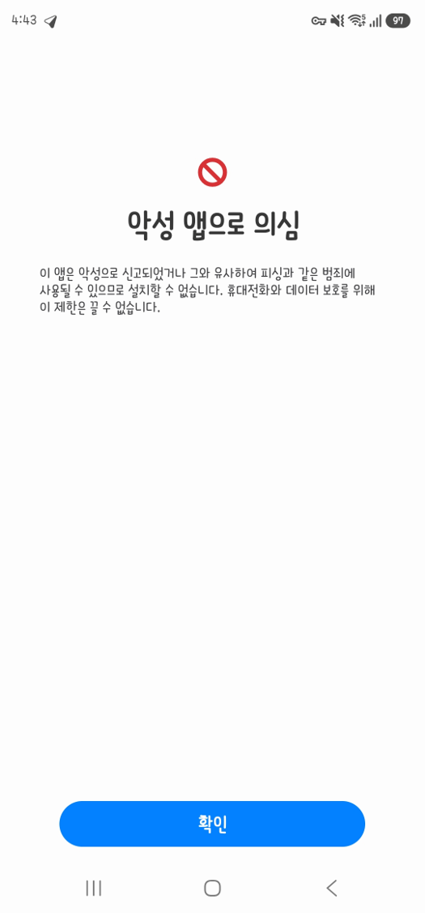
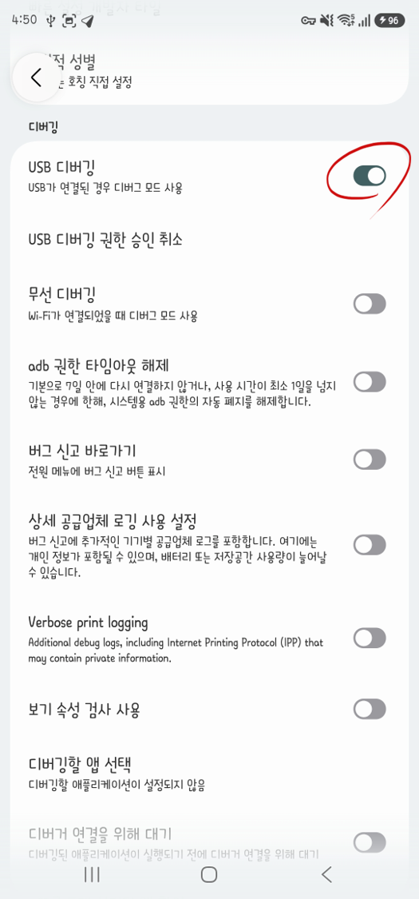
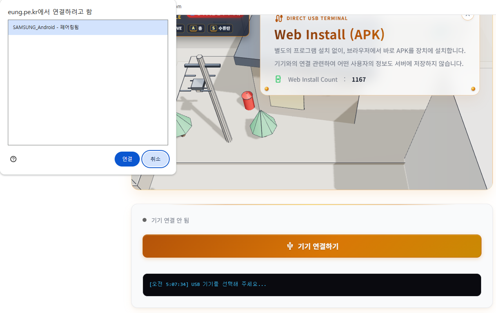
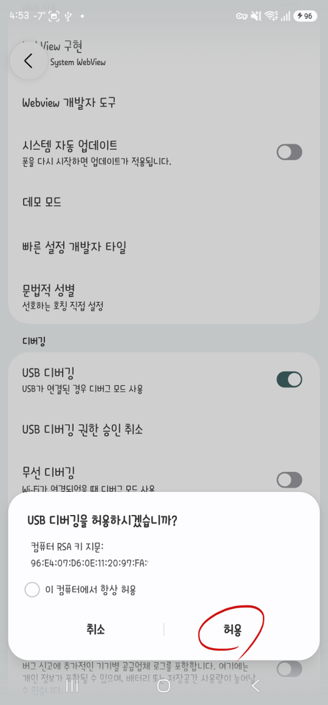
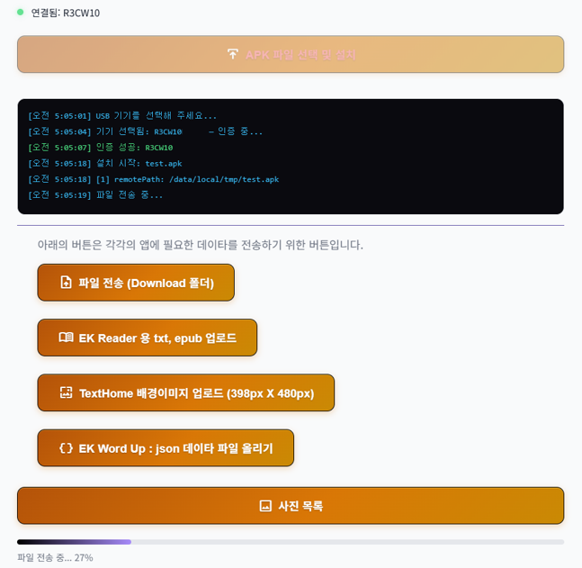
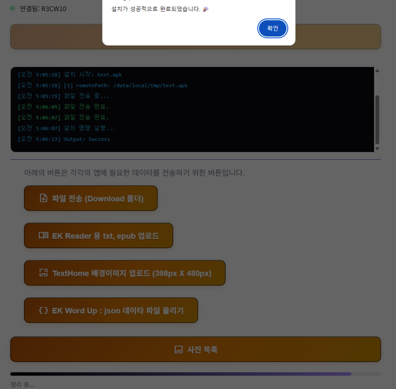
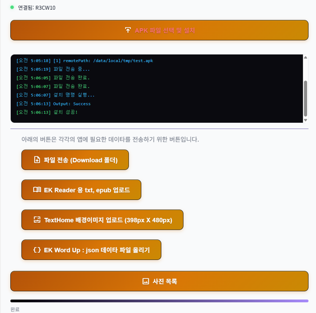

# '악성 앱으로 의심'이라니 😮

간혹 회사 앱이나 자체 개발 앱을 설치하려고 하면 안드로이드에서는 '악성 앱으로 의심' 알림이 뜬다. 문제는 여기서 더 이상 진행이 안 되고, 설치 버튼이 뜨지 않는다. 

이미 나와 같은 문제를 겪었떤 선구자(?)들은 이를 해결할 방법을 찾았다. 모바일에서는 Shizuku를 설치한 후에 무선 ADB 활성화를 통해 설치하는 방법, PC에서는 안드로이드 SDK를 설치한 후에 직접 adb 명령어로 설치하는 방법이 있다. ([기존 방법 참고](https://remake.tistory.com/213)) 그런데 이것도 귀찮다. Shizuku는 재부팅할 때마다 다시 시작해야 하고, SDK는 설치부터가 일이다. 😇   
그러다 WebUSB로 Installer를 구현해 놓은 사이트를 찾았다. [EUNG SOFT Web Install](https://eung.pe.kr/web-install/)다.  별도의 프로그램 설치 없이, 브라우저에서 바로 APK 파일을 휴대폰에 설치한다. 👍

# 웹사이트에서 설치하는 방법

순서는 단순하다.

## 1단계: 개발자 옵션·USB 디버깅 활성화

설정에서 휴대전화 정보를 열고 빌드번호를 7번 연속으로 누르면 개발자 옵션이 생긴다. 개발자 옵션 안에서 USB 디버깅을 켠다.

## 2단계: PC와 USB로 연결하고 웹사이트 접속

데이터 통신이 가능한 USB 케이블로 PC와 휴대폰을 연결한다. 충전 전용 케이블은 안 된다. PC의 Chrome이나 Edge에서 [Web Install](https://eung.pe.kr/web-install/)에 접속한다. Safari, Firefox는 지원 안 한다.

## 3단계: 기기 연결

"기기 연결하기" 버튼을 클릭하고, 브라우저 팝업에서 기기를 선택한다. 갤럭시의 경우 'SAMSUNG_Android'로 기기가 표시된다.

## 4단계: USB 디버깅 허용

휴대폰 화면에 "USB 디버깅을 허용하시겠습니까?" 팝업이 뜨면 허용을 누른다.

## 5단계: APK 선택 및 설치

연결 성공 후 "APK 파일 선택 및 설치" 버튼으로 원하는 APK를 선택한다.   
그럼 끝이다. 😀

  

# 왜 이 방법이 편한가

별도의 프로그램을 설치할 필요가 없다. SDK도, Shizuku도 필요 없다. WebUSB이다 보니 ****adb 전송이 막혀있는 회사에서도 APK 파일을 설치할 수 있다.****
 기기와의 연결 관련 정보는 서버에 저장하지 않는다고 한다.   
사이트에 사용법 동영상도 있으니, 글로 안 되면 영상으로 확인하면 된다. 
어려울 것 없는 방법이다 보니 크롬 즐겨찾기에 추가 해놓고 APK 파일 설치 때마다 활용중이다. 뵌 적은 없지만 만들어주신 EUNG님께 감사드립니다.👍 앞으로도 쭉 유지해주세요! 🙏
